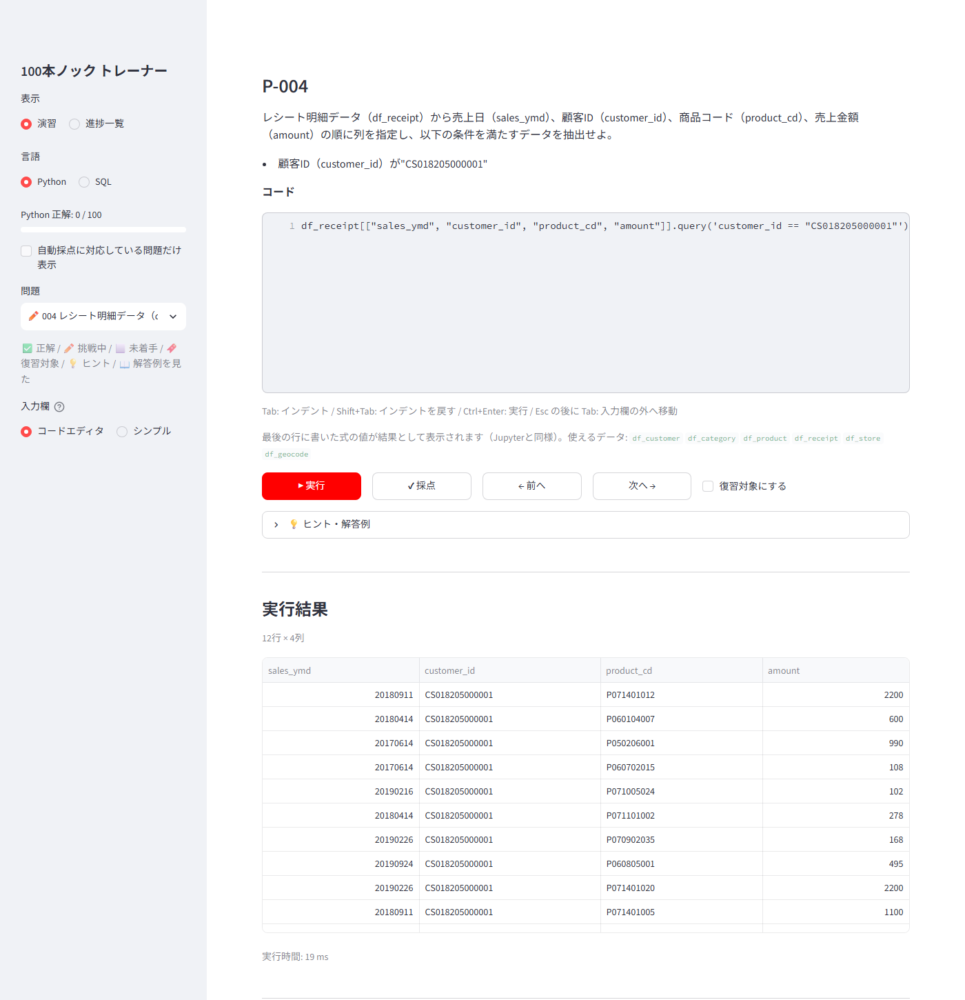
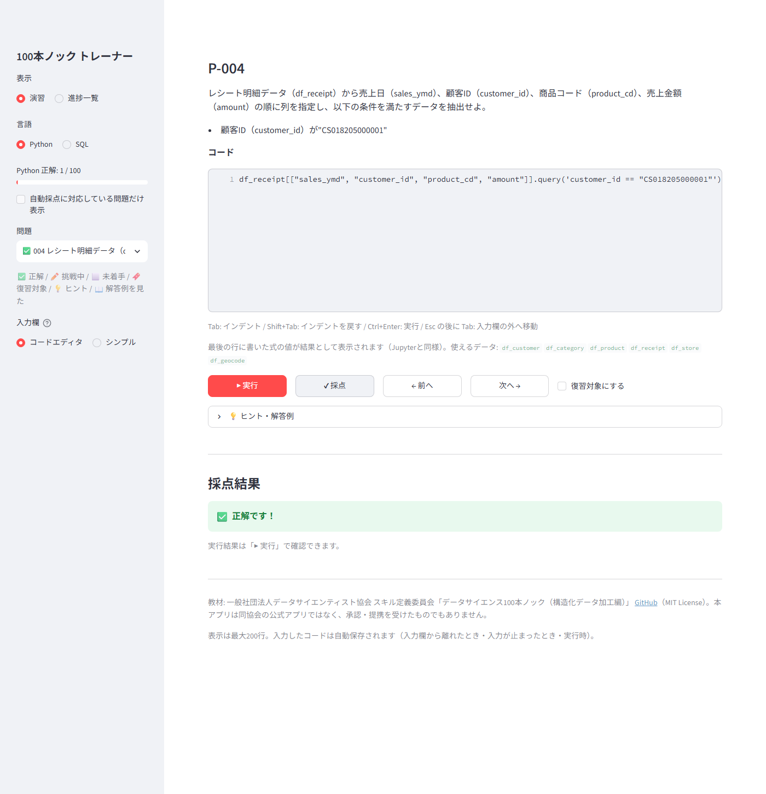
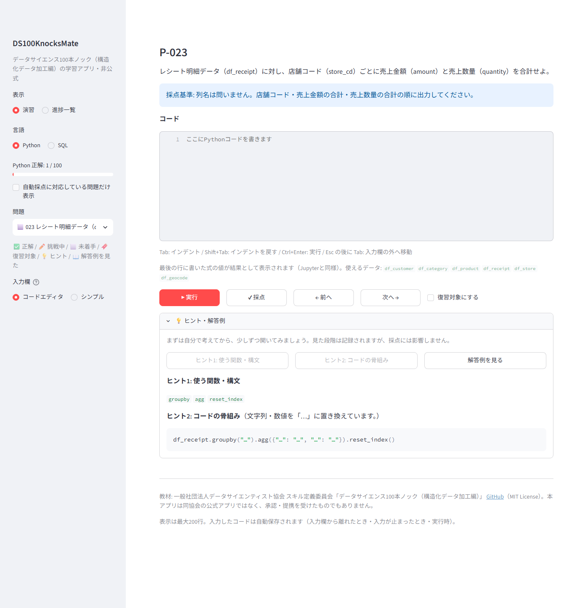
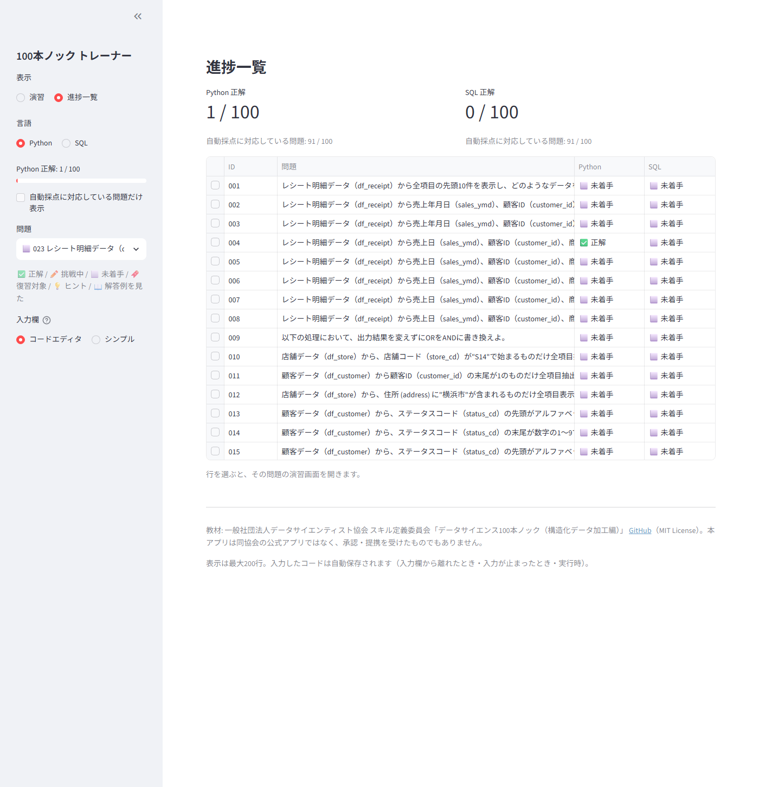

# DS100KnocksMate（非公式）

「データサイエンス100本ノック（構造化データ加工編）」を、**自分のPCのブラウザで Python / SQL を書いて、その場で実行・自動採点・進捗保存**しながら解ける学習アプリです。

- 自分のPCの中だけで動きます（アカウント不要、書いたコードを外部に送りません）
- Python と SQL で同じ問題に別々に挑戦でき、進捗も言語ごとに記録されます
- 書いたコードと正解状態は自動保存され、アプリを閉じても残ります
- 行き詰まったら、ヒント → コードの骨組み → 解答例 の順に少しずつ見られます

> 本アプリは一般社団法人データサイエンティスト協会の公式アプリではなく、承認・提携を受けたものでもありません。教材の出典は[下記](#出典ライセンス)を参照してください。



| 採点 | ヒント・解答例 | 進捗一覧 |
| --- | --- | --- |
|  |  |  |

## できること

| 項目 | 内容 |
| --- | --- |
| 問題 | 100問すべての問題文（Python 版・SQL 版） |
| 実行 | Python（pandas 3 など）と SQL（PostgreSQL 16）をその場で実行し、表・値・標準出力・エラーを表示 |
| 自動採点 | **91問**（Python・SQL とも）。正解が1つに決まらない9問（乱数・カテゴリ名が自由など）は、理由と確認のポイントを表示して自動採点しません |
| ヒント・解答例 | 使う関数・構文 → コードの骨組み → 解答例（出典つき）の3段階 |
| 進捗 | 言語別の正解数、全問題の状態一覧、復習フラグ |
| SQL でのテーブル作成 | 「データを作成せよ」という問題では CREATE TABLE なども実行できます（実行後に自動で取り消され、教材データは変わりません） |
| ファイル入出力 | Python は `./data` に出力します。SQL は安全のため `COPY ... TO STDOUT` / `COPY ... FROM STDIN` を使います（画面に案内が出ます） |

## 必要なもの

- **Docker Desktop**（[公式サイト](https://www.docker.com/products/docker-desktop/)からインストール）
- このリポジトリのファイル（`git clone` するか、GitHub の「Code → Download ZIP」で取得して展開）
- ディスク空き容量: 数GB程度（初回にアプリの部品をダウンロード・組み立てるため）

動作確認済み: Windows 11 + Docker Desktop（WSL2）。macOS は未確認です（起動用ファイルは用意していますが、実機では試していません）。

## 起動する

### かんたんな方法（ダブルクリック）

- **Windows**: フォルダ内の **`start.bat`** をダブルクリック
- **macOS**: フォルダ内の **`start.command`** をダブルクリック（初回に「開発元を確認できない」と表示された場合は、右クリック →「開く」。それでも開けない場合はターミナルで `bash start.command`）

Docker Desktop が起動していなければ自動で起動し、準備ができるとブラウザで **http://127.0.0.1:8501** が開きます。初回は部品のダウンロードと組み立てで数分かかります。
うまく起動しない場合は「[困ったとき](#困ったとき)」を参照してください。

### コマンドで起動する

```bash
docker compose up -d --build
```

その後、ブラウザで **http://127.0.0.1:8501** を開きます。

### ポートを変える

ポート 8501 がほかのアプリで使われている場合は、`KNOCKS_PORT` で変更できます。

```powershell
# Windows（PowerShell）
$env:KNOCKS_PORT=8600; docker compose up -d --build   # → http://127.0.0.1:8600
```

```bash
# macOS / Linux
KNOCKS_PORT=8600 docker compose up -d --build
```

起動用ファイルでも同じ指定が使えます（Windows: PowerShell で `$env:KNOCKS_PORT=8600; .\start.bat`、macOS: `KNOCKS_PORT=8600 bash start.command`）。

## 使い方

1. 左のサイドバーで **言語（Python / SQL）** と **問題** を選びます。
2. 問題文を読み、「コード」欄に解答を書きます。
   - **Python**: 最後の行に書いた式の値が結果として表示されます（Jupyter と同じ）。`df_receipt` などのデータは最初から使えます。
   - **SQL**: SELECT 文（WITH 句を含む）を1つ書きます。データベースは読み取り専用なので、壊れる心配はありません。
   - 入力欄では **Tab**（インデント）、**Shift+Tab**（インデントを戻す）、**Ctrl+Enter**（実行）が使えます。うまく動かない場合はサイドバーの「入力欄」を「シンプル」に切り替えてください。
3. **▶ 実行** で結果を確認し、納得したら **✔ 採点** を押します（実行だけでは正解になりません）。
4. 採点結果は「正解 / 不正解（理由つき）/ 自動採点できない / エラー」のいずれかで表示されます。問題によっては「採点基準」（例: 列名は問いません）が表示されます。
5. 行き詰まったら **💡 ヒント・解答例** を開きます。見た段階は記録されますが、採点には影響しません。
6. サイドバーの「表示」を **進捗一覧** にすると、全問題の状態を Python / SQL 別に確認できます。

サイドバーの印: ✅ 正解 / ✏️ 挑戦中 / ⬜ 未着手 / 🔖 復習対象 / 💡 ヒントを見た / 📖 解答例を見た

コードは、入力欄から離れたとき・入力が1.5秒止まったとき・実行や採点をしたときに自動保存されます。

## 終了する・再開する

- **Windows**: `stop.bat` をダブルクリック（再開は `start.bat`）
- **macOS**: `stop.command` をダブルクリック（再開は `start.command`）
- コマンド: `docker compose down`（終了）／ `docker compose up -d`（再開）

> ⚠️ `docker compose down -v` のように **`-v` を付けると学習履歴も削除されます**。

## 困ったとき

### 「CERTIFICATE_VERIFY_FAILED」（証明書を確認できない）で組み立てに失敗する

ウイルス対策ソフトの HTTPS 検査（「Web 保護」「HTTPS スキャン」など）や、会社・学校のネットワーク（プロキシ）が通信を検査していると、アプリの部品をダウンロードするときにこのエラーになります。

- **起動用ファイル（`start.bat` / `start.command`）を使う場合**: エラーを見つけると理由を表示し、「この PC の証明書を使って組み立て直しますか？」と確認します。Enter（または `y`）で、PC が信頼している証明書を `docker/certs/host-trusted-roots.crt` に書き出して組み立て直します。書き出したファイルは Git の管理対象外で、公開されません。
- **それでも失敗する場合・コマンドで起動する場合**: 検査に使われている証明書（PEM 形式、拡張子 `.crt`）を `docker/certs` フォルダに置いてから、もう一度起動します。会社・学校のネットワークでは、管理者に「プロキシ（または TLS 検査）のルート証明書」をもらってください。詳しくは [docker/certs/README.md](docker/certs/README.md)。
- 置いた証明書が不要になったら、`docker/certs` から削除して、もう一度起動（組み立て直し）します。

### ポート 8501 が使われていて起動できない

「port is already allocated」などと表示された場合は、ほかのアプリが同じポートを使っています。「[ポートを変える](#ポートを変える)」の方法で別のポートを指定してください。

### `start.bat` のウィンドウがすぐ閉じる・何も起きない

PowerShell の実行が制限されている可能性があります。フォルダ内で PowerShell を開き、次を実行するとメッセージを確認できます。

```powershell
powershell -NoProfile -ExecutionPolicy Bypass -File .\scripts\windows\start.ps1
```

### Docker Desktop が起動しない

Docker Desktop を手動で起動し、画面左下が「Engine running」になってから、もう一度起動用ファイルを実行してください。

## 学習履歴の保存場所

書いたコード・実行/採点の履歴・進捗は、Docker のボリューム **`ds100knocks_progress`** 内の SQLite ファイルに保存されます。このフォルダの中には保存されないため、Git にコミットされることもありません。

## アップデートする

新しい版のファイルを取得してから（`git pull` など）、`start.bat` / `start.command` を実行するか `docker compose up -d --build` を実行します。学習履歴はそのまま引き継がれます（形式の変更は自動で移行されます）。

## アンインストール

```bash
docker compose down -v --rmi local   # コンテナ・学習履歴・このアプリのイメージを削除
```

その後、このフォルダを削除します。

## 採点のしくみと限界

- 正誤は **コードの文字列ではなく実行結果** で判定します。教材の模範解答を同じ環境で実行した結果（参照結果）と比べるので、書き方が違っても結果が同じなら正解です。
- 「先頭10件を表示」のような問題では、条件を満たす10行であれば、どの10行でも正解です（SQL の `LIMIT` は行の順序が決まらないため）。
- 問題文が許す範囲の違い（分散の種類、対数化前の +0.5、四捨五入/偶数丸め、列名など）は正解として扱い、画面の「採点基準」に明記しています。
- **限界**: 教材のデータ1組に対する結果で比べるため、このデータでは区別できない誤り（例: 重複がないデータでの `DISTINCT` の有無）は正解になることがあります。「OR を AND に書き換えよ」のような書き方を問う問題も、結果だけで判定します。
- 乱数を使う問題のうち 089・091 は性質（重なりがない、比率が合っている等）で採点し、075・076 などは自動採点しません。
- 上流の解答例が pandas 3 で動かない問題や、上流の解答例に誤りがある問題（092 の SQL）は、解答例の画面に注記しています。詳しくは [docs/UPSTREAM_SOURCE.md](docs/UPSTREAM_SOURCE.md)。

## 安全性について

- アプリは自分のPC（127.0.0.1）からのみ開けます。LAN やインターネットには公開しません。
- 書いた Python コードは、画面とは別の隔離されたコンテナで実行されます（時間・メモリ・ファイル書き込みの制限あり、インターネットや DB には接続不可）。
- SQL は SELECT のみ許可された権限で実行され、教材データを変更できません。テーブルを作る問題でも、作れるのは一時テーブルだけで、実行後に必ず取り消されます。
- 本人がローカルで使うことを前提にした設計です。**インターネットに公開して他人のコードを実行させる用途には使わないでください。** 詳しくは [SECURITY.md](SECURITY.md)。

## 出典・ライセンス

- 本アプリのコード: [MIT License](LICENSE)（Copyright (c) 2026 sim0407）
- 教材: 一般社団法人データサイエンティスト協会 スキル定義委員会「データサイエンス100本ノック（構造化データ加工編）」
  https://github.com/The-Japan-DataScientist-Society/100knocks-preprocess （MIT License。ガイドPDFと協会ロゴは CC BY-ND のため同梱していません）
- 同梱した教材ファイルと取得元の commit: [THIRD_PARTY_NOTICES.md](THIRD_PARTY_NOTICES.md)
- 依存ライブラリのライセンス: [docs/DEPENDENCY_LICENSES.md](docs/DEPENDENCY_LICENSES.md)

---

## 開発者向け

[uv](https://docs.astral.sh/uv/) と Docker Desktop を使います（Python 3.12 は uv が用意します）。CI（`.github/workflows/ci.yml`）でも同じテストを実行します。

```bash
uv sync                                                # 依存をインストール
uv run pytest                                          # 単体テスト（Docker不要。fork のテストはワーカーのコンテナで実行）
uv run ruff check . && uv run ruff format --check .    # lint / format
docker compose --profile test run --rm --build tests   # 統合テスト（DB・ワーカー・UI）
docker compose --profile test down
docker build -f docker/worker/Dockerfile --target test -t knocks-worker:test .
docker run --rm --init knocks-worker:test              # ワーカーのテスト（fork による隔離を含む）
uv run python -m tools.extract_problems                # 同梱教材から問題カタログを再生成
```

E2E確認（学習履歴を書き換えるため、E2E用のプロジェクト名・ポートで実行。毎回 `down -v` で初期化してから）:

```bash
docker compose -p ds100knocks-e2e down -v
KNOCKS_PORT=8502 docker compose -p ds100knocks-e2e up -d --build --wait
uv sync --group e2e && uv run --group e2e playwright install chromium   # 初回のみ
KNOCKS_E2E_URL=http://127.0.0.1:8502 uv run --group e2e pytest tests/e2e -m e2e   # 実ブラウザ
KNOCKS_E2E_URL=http://127.0.0.1:8502 uv run --group e2e python -m tools.screenshots  # README の画像
docker compose -p ds100knocks-e2e down -v
```

構成:

| ディレクトリ | 内容 |
| --- | --- |
| `app/` | Streamlit UI（`editor.py` はコード入力用の軽量エディタ） |
| `core/` | 問題カタログ・ヒント・実行クライアント・採点・学習履歴（UI非依存） |
| `worker/` | 学習者の Python を隔離実行するワーカー |
| `docker/` | 各コンテナの Dockerfile、教材DBの初期化SQL |
| `exercises/` | 問題カタログ（生成物）、採点定義（`problems/*.toml`）、解答例の注記 |
| `upstream/` | 原教材のスナップショット（無改変） |
| `tools/` | 教材の同梱・問題抽出・依存ライセンス一覧・スクリーンショット |
| `scripts/windows/` | Windows の起動用ファイルの本体（`start.bat` / `stop.bat` から呼ぶ PowerShell） |
| `docs/` | 要件・設計・計画・決定事項・教材の出典・公開前の確認手順・依存ライセンス |
